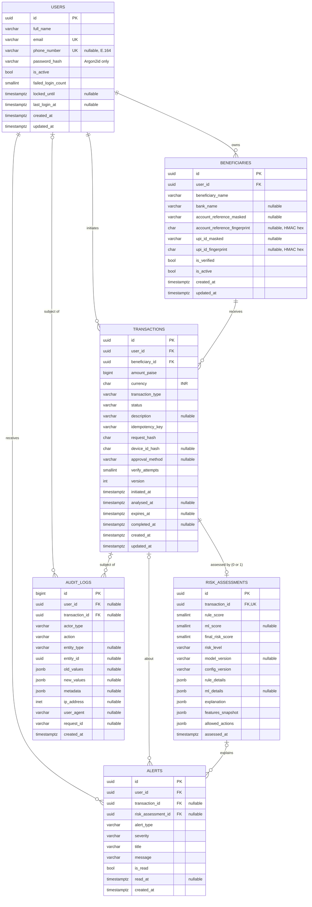

# SakshamPay database schema (P-4)

Six PostgreSQL tables, defined as SQLAlchemy 2.x models in `backend/app/models/` and
created by the Alembic migrations in `backend/migrations/versions/` (P-5).

## Conventions

| Topic | Rule |
| --- | --- |
| Primary keys | UUID (`gen_random_uuid()` in the database, `uuid4()` in Python) for every table except `audit_logs`, which uses a `BIGINT` identity for cheap, ordered, append-only inserts |
| Timestamps | `TIMESTAMPTZ` everywhere, defaulting to `now()` in the database |
| Money | `amount_paise BIGINT`, always > 0; never `FLOAT`/`NUMERIC`. ₹1,234.50 is stored as `123450` |
| Enumerations | `VARCHAR` + named `CHECK` constraint (not native PostgreSQL `ENUM`), so adding a value later is a simple migration |
| Scores | `SMALLINT` with `CHECK (0..100)` |
| Structured data | `JSONB`, with `CHECK (jsonb_typeof(...))` where the shape is known. Nullable JSONB columns store Python `None` as SQL `NULL` (`none_as_null=True`), never the JSON value `null` |
| Deletion | Every foreign key is `ON DELETE RESTRICT`. Nothing financial or audit-related is ever hard-deleted; users and beneficiaries are deactivated with `is_active = false` |
| Concurrency | `transactions.version` is SQLAlchemy's optimistic-lock counter: a stale update raises `StaleDataError` |
| Constraint names | Deterministic, from the naming convention in `app/database/base.py` (`pk_`, `fk_`, `uq_`, `ck_`, `ix_`) |

## Entity relationships

Besides the single-column foreign keys drawn above, three composite foreign keys
enforce ownership in the database (see "Cross-row integrity").

## Tables

### users

Account holders. Registration and login arrive in P-6.

| Column | Type | Null | Default | Notes |
| --- | --- | --- | --- | --- |
| id | UUID | no | `gen_random_uuid()` | PK |
| full_name | VARCHAR(100) | no | | trimmed, 1–100 characters |
| email | VARCHAR(254) | no | | stored lower-case; unique |
| phone_number | VARCHAR(16) | yes | | E.164 (`+919876543210`); unique when present |
| password_hash | VARCHAR(255) | no | | must start with `$argon2id$` |
| is_active | BOOLEAN | no | `true` | deactivate instead of delete |
| failed_login_count | SMALLINT | no | `0` | 0–100; for P-1 lockout rule |
| locked_until | TIMESTAMPTZ | yes | | lockout end |
| last_login_at | TIMESTAMPTZ | yes | | |
| created_at / updated_at | TIMESTAMPTZ | no | `now()` | `updated_at` refreshed on every ORM update |

Constraints: `uq_users_email`, `uq_users_phone_number`, `ck_users_email_lowercase`,
`ck_users_email_format`, `ck_users_full_name_not_blank`, `ck_users_phone_e164`,
`ck_users_password_hash_argon2id`, `ck_users_failed_login_count_range`.

### beneficiaries

Payees saved by a user. Fictional payees only; no bank or UPI integration.

| Column | Type | Null | Default | Notes |
| --- | --- | --- | --- | --- |
| id | UUID | no | | PK |
| user_id | UUID | no | | FK → users, RESTRICT |
| beneficiary_name | VARCHAR(100) | no | | not blank |
| bank_name | VARCHAR(100) | yes | | |
| account_reference_masked | VARCHAR(34) | yes | | display form, e.g. `XXXXXXXX4321` |
| account_reference_fingerprint | CHAR(64) | yes | | HMAC-SHA256 hex of the normalised account reference |
| upi_id_masked | VARCHAR(100) | yes | | display form, e.g. `ra****@okaxis` |
| upi_id_fingerprint | CHAR(64) | yes | | HMAC-SHA256 hex of the lower-cased UPI ID |
| is_verified | BOOLEAN | no | `false` | simulated name check |
| is_active | BOOLEAN | no | `true` | soft delete; history keeps pointing here |
| created_at / updated_at | TIMESTAMPTZ | no | `now()` | |

Constraints: at least one of account reference / UPI ID
(`ck_beneficiaries_has_payment_identifier`); each masked value present exactly when its
fingerprint is (`ck_..._account_reference_pair`, `ck_..._upi_id_pair`); fingerprints are
64 lower-case hex characters; duplicates per user blocked by
`uq_beneficiaries_user_id_account_reference_fingerprint` and
`uq_beneficiaries_user_id_upi_id_fingerprint`; `uq_beneficiaries_id_user_id` is the
target of the ownership foreign key from `transactions`.

Index: `ix_beneficiaries_user_id_created_at`.

### transactions

One row per simulated payment attempt and its lifecycle state.

| Column | Type | Null | Default | Notes |
| --- | --- | --- | --- | --- |
| id | UUID | no | | PK |
| user_id | UUID | no | | FK → users, RESTRICT |
| beneficiary_id | UUID | no | | FK → beneficiaries, RESTRICT; must belong to `user_id` |
| amount_paise | BIGINT | no | | > 0 |
| currency | CHAR(3) | no | `'INR'` | only INR accepted |
| transaction_type | VARCHAR(16) | no | | `P2P`, `P2M` |
| status | VARCHAR(32) | no | `'INITIATED'` | P-1 lifecycle (7 states) |
| description | VARCHAR(80) | yes | | user note |
| idempotency_key | VARCHAR(128) | no | | unique per user; 8–128 characters |
| request_hash | CHAR(64) | no | | SHA-256 of the request body; detects key reuse with a different payload |
| device_id_hash | CHAR(64) | yes | | HMAC of the browser device ID |
| approval_method | VARCHAR(16) | yes | | `CONTINUE` or `VERIFIED`; set only when APPROVED |
| verify_attempts | SMALLINT | no | `0` | 0–3 |
| version | INTEGER | no | `1` | optimistic-lock counter (SQLAlchemy `version_id_col`) |
| initiated_at | TIMESTAMPTZ | no | `now()` | |
| analysed_at | TIMESTAMPTZ | yes | | set when the assessment is stored |
| expires_at | TIMESTAMPTZ | yes | | action deadline while AWAITING_USER_ACTION |
| completed_at | TIMESTAMPTZ | yes | | set on reaching a terminal state |
| created_at / updated_at | TIMESTAMPTZ | no | `now()` | |

Lifecycle checks:

- `ck_transactions_analysed_at_required`: every state after ANALYSED (except FAILED) has `analysed_at`. A transaction cannot be APPROVED, CANCELLED or EXPIRED without having been assessed.
- `ck_transactions_completed_at_matches_status`: `completed_at` is set exactly for APPROVED, CANCELLED, EXPIRED, FAILED.
- `ck_transactions_approval_method_matches_status`: `approval_method` is set exactly when APPROVED.
- `ck_transactions_expires_at_required`: AWAITING_USER_ACTION has an `expires_at`.
- `ck_transactions_timestamps_ordered`: initiated ≤ analysed ≤ completed.

Indexes: `uq_transactions_user_id_idempotency_key`, `ix_transactions_user_id_created_at`
(history and feature windows), `ix_transactions_beneficiary_id_created_at`,
`ix_transactions_status`, `ix_transactions_created_at`, partial
`ix_transactions_awaiting_expires_at` (expiry sweep) and partial
`ix_transactions_initiated_initiated_at` (stale-INITIATED sweep).

### risk_assessments

The immutable result of assessing one transaction.

| Column | Type | Null | Notes |
| --- | --- | --- | --- |
| id | UUID | no | PK |
| transaction_id | UUID | no | FK → transactions, RESTRICT; **unique** |
| rule_score | SMALLINT | no | 0–100 (rule points capped at 100) |
| ml_score | SMALLINT | yes | 0–100 calibrated anomaly rank; NULL when the model was unavailable |
| final_risk_score | SMALLINT | no | 0–100; see formula check |
| risk_level | VARCHAR(8) | no | LOW, MEDIUM, HIGH |
| model_version | VARCHAR(64) | yes | present exactly when `ml_score` is |
| config_version | VARCHAR(64) | no | rule/threshold configuration used |
| rule_details | JSONB | no | array of rule hits (id, points, observed values) |
| ml_details | JSONB | yes | object: raw anomaly value, percentile, most unusual features; present exactly when `ml_score` is |
| explanation | JSONB | no | ordered array of user-facing factors |
| features_snapshot | JSONB | no | object: the feature vector that was scored |
| allowed_actions | JSONB | no | non-empty array of actions the decision engine allowed |
| assessed_at | TIMESTAMPTZ | no | `now()` |

`ck_risk_assessments_final_score_formula` enforces the approved formula in the database:

- with ML: `final_risk_score = round((3 × rule_score + 2 × ml_score) / 5)`, which is exactly
  `round(0.6 × rule + 0.4 × ml)` in integer arithmetic (it can never land on .5, so rounding is unambiguous);
- without ML (P-1 fallback): `final_risk_score = rule_score`.

`risk_level` is not tied to the score in the database because the bands are
configurable and P-1 raises LOW to MEDIUM when ML is unavailable.

**One assessment per transaction.** A retry after a failure is a new transaction
(new idempotency key), and P-1 treats an assessment as an immutable record of the
decision the user saw. The unique `transaction_id` guarantees there is never doubt about
which assessment justified an approval. Re-scoring for analysis belongs in offline
evaluation, not in this table.

### alerts

In-app notifications.

| Column | Type | Null | Default | Notes |
| --- | --- | --- | --- | --- |
| id | UUID | no | | PK |
| user_id | UUID | no | | FK → users, RESTRICT |
| transaction_id | UUID | yes | | FK → transactions, RESTRICT; must belong to `user_id` |
| risk_assessment_id | UUID | yes | | FK → risk_assessments, RESTRICT; must belong to `transaction_id` |
| alert_type | VARCHAR(32) | no | | RISK_WARNING, TRANSACTION_APPROVED, TRANSACTION_CANCELLED, TRANSACTION_EXPIRED, TRANSACTION_FAILED, VERIFICATION_FAILED, ACCOUNT_LOCKED, SECURITY_NOTICE |
| severity | VARCHAR(16) | no | | INFO, WARNING, CRITICAL |
| title | VARCHAR(120) | no | | not blank |
| message | VARCHAR(500) | no | | not blank |
| is_read | BOOLEAN | no | `false` | |
| read_at | TIMESTAMPTZ | yes | | set exactly when `is_read` |
| created_at | TIMESTAMPTZ | no | `now()` | |

Indexes: `ix_alerts_user_id_is_read_created_at`, `ix_alerts_transaction_id`,
`ix_alerts_risk_assessment_id`.

### audit_logs

Append-only record of security and transaction events.

| Column | Type | Null | Notes |
| --- | --- | --- | --- |
| id | BIGINT identity | no | PK |
| user_id | UUID | yes | FK → users, RESTRICT; the account the event concerns |
| transaction_id | UUID | yes | FK → transactions, RESTRICT |
| actor_type | VARCHAR(16) | no | USER, SYSTEM (expiry sweep, startup), ANONYMOUS (e.g. failed login for an unknown email) |
| action | VARCHAR(64) | no | upper snake case, e.g. `TRANSACTION_STATUS_CHANGED` |
| entity_type / entity_id | VARCHAR(32) / UUID | yes | both or neither |
| old_values / new_values / metadata | JSONB | yes | objects only |
| ip_address | INET | yes | stored as a /24 (IPv4) or /48 (IPv6) network, per P-1 data minimisation |
| user_agent | VARCHAR(512) | yes | truncated |
| request_id | VARCHAR(64) | yes | links to application logs |
| created_at | TIMESTAMPTZ | no | `now()` |

Indexes: `ix_audit_logs_user_id_created_at`, `ix_audit_logs_transaction_id_created_at`,
`ix_audit_logs_action_created_at`, `ix_audit_logs_created_at`,
`ix_audit_logs_entity_type_entity_id`.

Append-only: the ORM refuses to UPDATE or DELETE an `AuditLog` (and a `RiskAssessment`).
JSON fields reject keys such as `password`, `password_hash`, `token`, `jwt`, `secret`
and `authorization` at any depth. Since P-5, PostgreSQL triggers also refuse UPDATE, DELETE and
TRUNCATE on `audit_logs` and `risk_assessments`, and the least-privilege application role
has no UPDATE/DELETE on them (see `docs/database-operations.md`).

## Cross-row integrity

| Guarantee | How |
| --- | --- |
| A transaction's beneficiary belongs to the same user | composite FK `(beneficiary_id, user_id)` → `beneficiaries(id, user_id)` |
| An alert's transaction belongs to the alert's user | composite FK `(transaction_id, user_id)` → `transactions(id, user_id)` |
| An alert's risk assessment belongs to the alert's transaction | composite FK `(risk_assessment_id, transaction_id)` → `risk_assessments(id, transaction_id)` plus `CHECK (risk_assessment_id IS NULL OR transaction_id IS NOT NULL)` (composite FKs are not checked when any column is NULL) |

## Open issue: rule weights add up to 105

The P-1 rule points (new beneficiary 20, unusual amount 25, velocity 20, timing 10,
device/session 15, behavioural deviation 15) total **105**. P-1 caps the rule score with
`min(100, sum)`, so the schema stores `rule_score` in 0–100 and keeps the raw point total
inside `rule_details`. The weights themselves are unchanged pending a decision; options are
listed in the P-4 report.

## Tests

- `backend/tests/test_models.py`: metadata checks, no database needed.
- `backend/tests/test_models_postgres.py`: inserts valid and invalid rows into a real
  PostgreSQL (throwaway schema, dropped afterwards) to prove every constraint is enforced.
  Runs only when `TEST_DATABASE_URL` is set.
